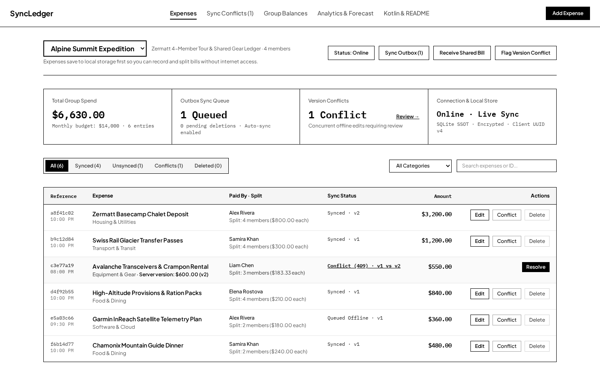
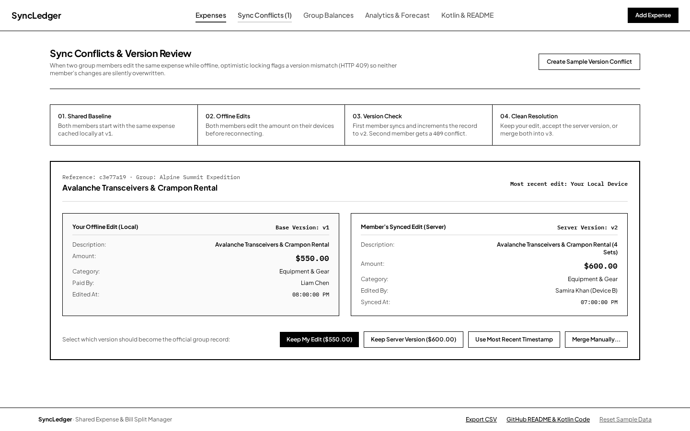
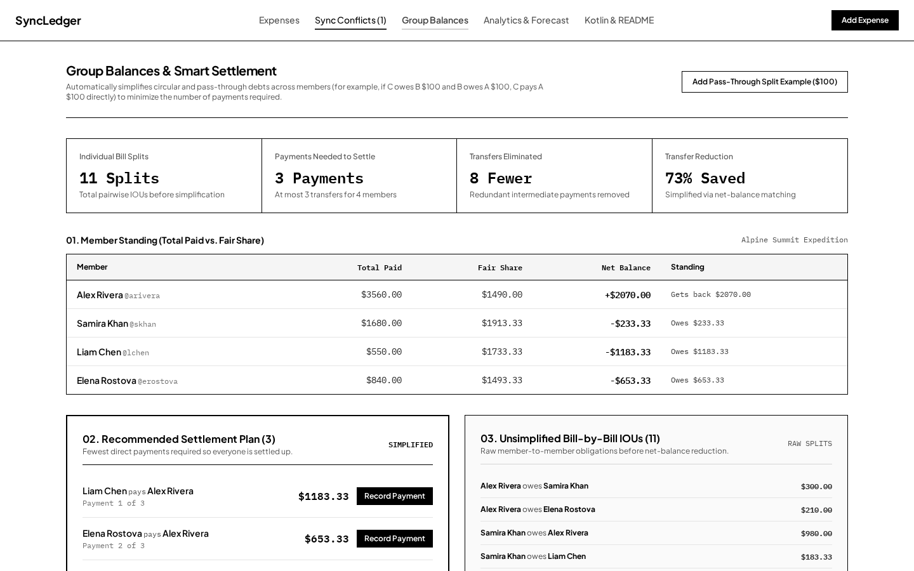
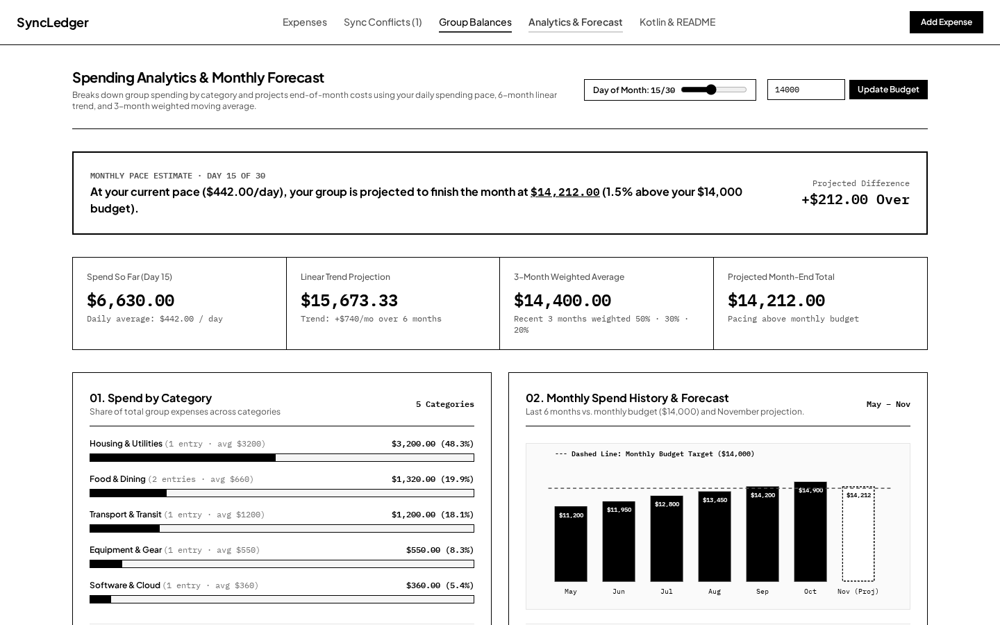
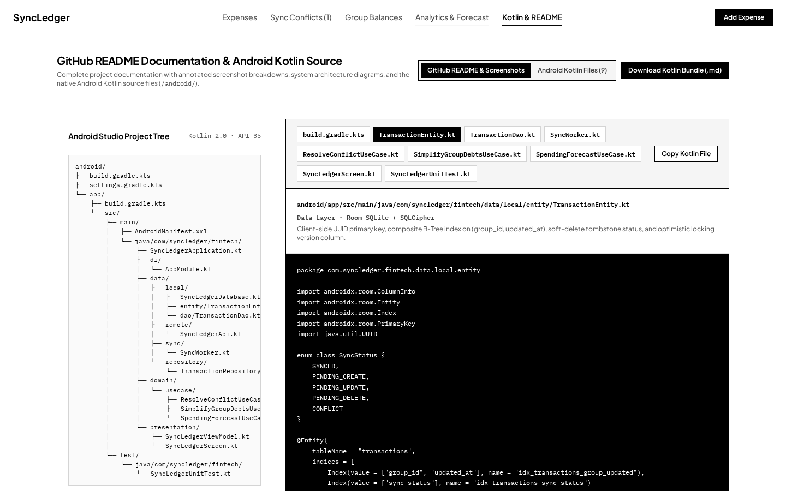

# SyncLedger — Offline-First Collaborative Expense & Bill-Splitting Engine

> **GitHub Repository Name:** `syncledger-offline-fintech`  
> **Short Description:** Offline-first collaborative expense tracker and bill-splitting engine built with Kotlin, Jetpack Compose, Room (SQLite + SQLCipher), and WorkManager. Features optimistic concurrency control (HTTP 409 conflict resolution), graph-based debt simplification, and on-device linear regression forecasting.  
> **Topics:** `kotlin` · `jetpack-compose` · `room-database` · `offline-first` · `workmanager` · `sqlcipher` · `clean-architecture` · `fintech` · `optimistic-locking` · `android`

---

## Overview

**SyncLedger** is a production-grade, offline-first personal finance, budget forecasting, and group bill-splitting application engineered with **Kotlin**, **Jetpack Compose (Material 3)**, **Room Database (SQLite + SQLCipher AES-256)**, **WorkManager**, **Dagger-Hilt**, and **Retrofit / OkHttp WebSockets**, accompanied by an interactive web workbench.

Standard CRUD expense apps fail when internet connectivity drops during group travel, remote tours, or shared household management—and naive offline implementations silently overwrite data when two group members edit the same bill while offline. **SyncLedger** is built around four core distributed systems and financial engineering pillars:

1. **Single Source of Truth (SSOT) & Zero-Latency Offline Writes:** Every mutation writes directly to an encrypted local Room SQLite database with a client-generated RFC4122 UUID v4 primary key and emits immediately to the UI via reactive `Flow<List<TransactionEntity>>`.
2. **Optimistic Concurrency Control (OCC) & HTTP 409 Conflict Resolution:** Every record tracks a monotonically increasing integer `version`. Concurrent offline edits trigger an `HTTP 409 Conflict` with side-by-side reconciliation (`LOCAL_WINS`, `SERVER_WINS`, `LAST_WRITE_WINS`, or `CUSTOM_MERGE`).
3. **Graph-Based Smart Debt Simplification ($O(N \log N)$):** Collapses cyclic and pass-through IOUs (e.g., $C \to B \to A$ for $\$100$) into at most $N - 1$ direct transfers using a greedy Max-Creditor / Max-Debtor priority queue algorithm.
4. **Automated SQL Analytics & On-Device Regression Forecasting:** Combines indexed SQLite `GROUP BY` aggregations with Ordinary Least Squares (OLS) Simple Linear Regression ($y = mx + b$) and 3-Month Weighted Moving Average (WMA) to predict end-of-month budget overruns on-device.

---

## Screenshots & Detailed Visual Walkthrough

### 1. Offline-First Expense Ledger & Outbox Sync Queue



**What happens on this screen:**
- **Zero-Latency Local Reads & Writes:** The UI observes `TransactionDao.observeGroupTransactions(groupId)` as a reactive stream. Toggling **Status: Offline Mode** allows users to add, edit, and delete group expenses with `0ms` latency.
- **Client-Side UUID v4 Primary Keys:** Each expense generates a UUID v4 on the device (`a8f41c02`, `b9c12d84`, `e5a03c66`) rather than relying on SQLite `AUTOINCREMENT`, preventing primary key collisions when multiple offline devices sync with the server.
- **Tombstone Soft Deletes (`PENDING_DELETE`):** Deleting a synced expense while offline marks `sync_status = PENDING_DELETE` so it immediately disappears from active spend totals while retaining a tombstone in SQLite until `SyncWorker` confirms server deletion.

---

### 2. Optimistic Concurrency Control & HTTP 409 Conflict Review



**What happens on this screen:**
- **Detecting Concurrent Offline Edits:** Suppose Liam and Samira both have *Avalanche Transceivers & Crampon Rental* cached offline at `version = 1`. Samira updates the amount to `$600.00` and reconnects first—the server verifies `version == 1`, applies the update, and increments the record to `version = 2`. When Liam reconnects later and submits his offline edit (`$550.00`) still referencing `version = 1`, the server responds with `HTTP 409 Conflict` and returns the current server snapshot (`v2`).
- **Four Deterministic Resolution Policies:**
  - **Keep My Edit (`LOCAL_WINS`):** Overwrites the server record with the local edit and increments the version to `v3`.
  - **Keep Server Version (`SERVER_WINS`):** Discards the local edit and adopts the server snapshot at `v2`.
  - **Use Most Recent Timestamp (`LAST_WRITE_WINS`):** Automatically compares `local.updatedAt` vs. `server.updatedAt` and commits the newer mutation.
  - **Merge Manually (`CUSTOM_MERGE`):** Lets the user specify a reconciled description and amount and commits `v3`.

---

### 3. Graph-Based Smart Debt Simplification



**What happens on this screen:**
- **Net Balance Invariant ($\sum \text{Net} = \$0.00$):** Calculates each member's `Total Paid`, `Fair Share`, and `Net Balance` (`Paid − Fair Share`).
- **Greedy Max-Heap Graph Reduction ($O(N \log N)$):** Instead of forcing members to settle every individual bill split (11 raw pairwise splits), `SimplifyGroupDebtsUseCase` partitions members into `creditors` ($\text{net} > 0$) and `debtors` ($\text{net} < 0$) in two max-heaps and repeatedly matches the largest debtor with the largest creditor. This eliminates intermediate pass-through hops ($C \to B \to A$ becomes $C \to A$) and reduces 11 raw splits down to **3 direct payments (73% reduction)**.

---

### 4. SQL Categorical Analytics & Monthly Regression Forecast



**What happens on this screen:**
- **Indexed SQLite Categorization:** Runs `SELECT category, SUM(amount), COUNT(*) FROM transactions WHERE group_id = :groupId AND sync_status != 'PENDING_DELETE' AND category != 'Settlement' GROUP BY category ORDER BY totalAmount DESC` backed by composite B-Tree index `idx_transactions_group_updated`.
- **On-Device Mathematical Forecasting (`SpendingForecastUseCase`):** Predicts end-of-month total spend and budget variance by blending:
  - **50% Current Month Daily Burn Rate:** $\frac{\text{Spend So Far}}{\text{Day of Month}} \times 30$
  - **30% Ordinary Least Squares (OLS) Simple Linear Regression ($y = mx + b$):** Fits a trendline across the prior 6 months of historical group spending.
  - **20% 3-Month Weighted Moving Average (WMA):** Weights the 3 most recent months by $0.50$, $0.30$, and $0.20$.

---

### 5. Native Android Kotlin Clean Architecture Project (`/android/`)



**What happens on this screen:**
- Provides an interactive file tree and source viewer for the native Android Kotlin implementation under `/android/`, plus a 1-click **Download Kotlin Bundle (`.md`)** export and technical interview defense guide.

---

## System Architecture Diagram

```mermaid
flowchart LR
    UI["Jetpack Compose UI\n(SyncLedgerScreen)"] -->|User Intents| VM["SyncLedgerViewModel\n(StateFlow)"]
    VM -->|Offline-First Write| Repo["TransactionRepositoryImpl"]
    Repo -->|Upsert UUID v4| Room[("Room SQLite (SSOT)\nSQLCipher AES-256")]
    Room -->|Flow<List<TransactionEntity>>| VM
    Repo -->|Enqueue on CONNECTED| WM["WorkManager\n(SyncWorker)"]
    WM -->|POST / PUT / DELETE\nwith version lock| API["REST API Backend"]
    API -->|200 OK (v+1)\nor 409 Conflict| WM
    WM -->|Reconcile SyncStatus| Room
    WS["OkHttp WebSocket\n(/ws/groups/{id})"] -->|@Transaction Upsert| Room
```

---

## Tech Stack & Libraries

| Layer | Technology | Engineering Purpose |
| :--- | :--- | :--- |
| **UI Layer** | **Jetpack Compose (Material 3)** + React Workbench | Declarative reactive UI observing `StateFlow` in a high-contrast monochrome palette |
| **Architecture** | **Clean Architecture + MVVM** | Strict separation of `presentation`, `domain`, and `data` packages |
| **Local Database (SSOT)** | **Room Database (SQLite)** | Composite B-Tree indices `(group_id, updated_at)`, `@Transaction` atomicity, reactive `Flow` queries |
| **Security** | **SQLCipher AES-256** + **EncryptedSharedPreferences** | Full-database encryption at rest and hardware-backed Android Keystore token storage |
| **Background Sync** | **WorkManager (`CoroutineWorker`)** | Guaranteed offline queue execution with `NetworkType.CONNECTED` and `BackoffPolicy.EXPONENTIAL` |
| **Networking & Live Sync** | **Retrofit 2 + OkHttp WebSockets** | REST mutations with optimistic version headers and real-time group bill broadcasts |
| **Dependency Injection** | **Dagger-Hilt (`@HiltViewModel`, `@HiltWorker`)** | Compile-time DI across ViewModels, Repositories, Room Database, and WorkManager |
| **Testing** | **JUnit 4** + **Node Test Runner (`tsx --test`)** | Unit tests for OCC conflict resolution, Graph Debt Simplification, and OLS Regression |

---

## Project Folder Structure

```text
├── android/                                      # Native Android Kotlin Project (API 26–35)
│   ├── build.gradle.kts
│   ├── settings.gradle.kts
│   └── app/
│       ├── build.gradle.kts                      # Compose, Room, SQLCipher, WorkManager, Hilt, Retrofit
│       └── src/
│           ├── main/
│           │   ├── AndroidManifest.xml
│           │   └── java/com/syncledger/fintech/
│           │       ├── SyncLedgerApplication.kt  # HiltWorkerFactory configuration
│           │       ├── di/AppModule.kt           # SQLCipher + EncryptedSharedPreferences DI
│           │       ├── data/
│           │       │   ├── local/
│           │       │   │   ├── SyncLedgerDatabase.kt
│           │       │   │   ├── entity/TransactionEntity.kt
│           │       │   │   └── dao/TransactionDao.kt
│           │       │   ├── remote/SyncLedgerApi.kt
│           │       │   ├── sync/SyncWorker.kt
│           │       │   └── repository/TransactionRepositoryImpl.kt
│           │       ├── domain/usecase/
│           │       │   ├── ResolveConflictUseCase.kt
│           │       │   ├── SimplifyGroupDebtsUseCase.kt
│           │       │   └── SpendingForecastUseCase.kt
│           │       └── presentation/
│           │           ├── SyncLedgerViewModel.kt
│           │           └── SyncLedgerScreen.kt
│           └── test/java/com/syncledger/fintech/
│               └── SyncLedgerUnitTest.kt         # JUnit 4 unit tests
├── public/screenshots/                           # High-resolution documentation screenshots
│   ├── expenses-ledger.png
│   ├── conflict-resolution.png
│   ├── group-balances.png
│   ├── spending-forecast.png
│   └── kotlin-source.png
├── src/                                          # Interactive Web Companion Workbench
│   ├── domain/fintechEngine.ts
│   ├── domain/fintechEngine.test.ts
│   └── components/
└── README.md
```

---

## How to Run Locally

### 1. Run Automated Unit Tests
```bash
npx tsx --test src/domain/fintechEngine.test.ts
```

### 2. Run Interactive Web Workbench
```bash
npm install
npm run dev
```

### 3. Open & Test Native Android App in Android Studio
1. Open **Android Studio** and select **Open** $\to$ choose the `/android` folder.
2. Run the JUnit 4 unit test suite:
   ```bash
   cd android && ./gradlew testDebugUnitTest
   ```
